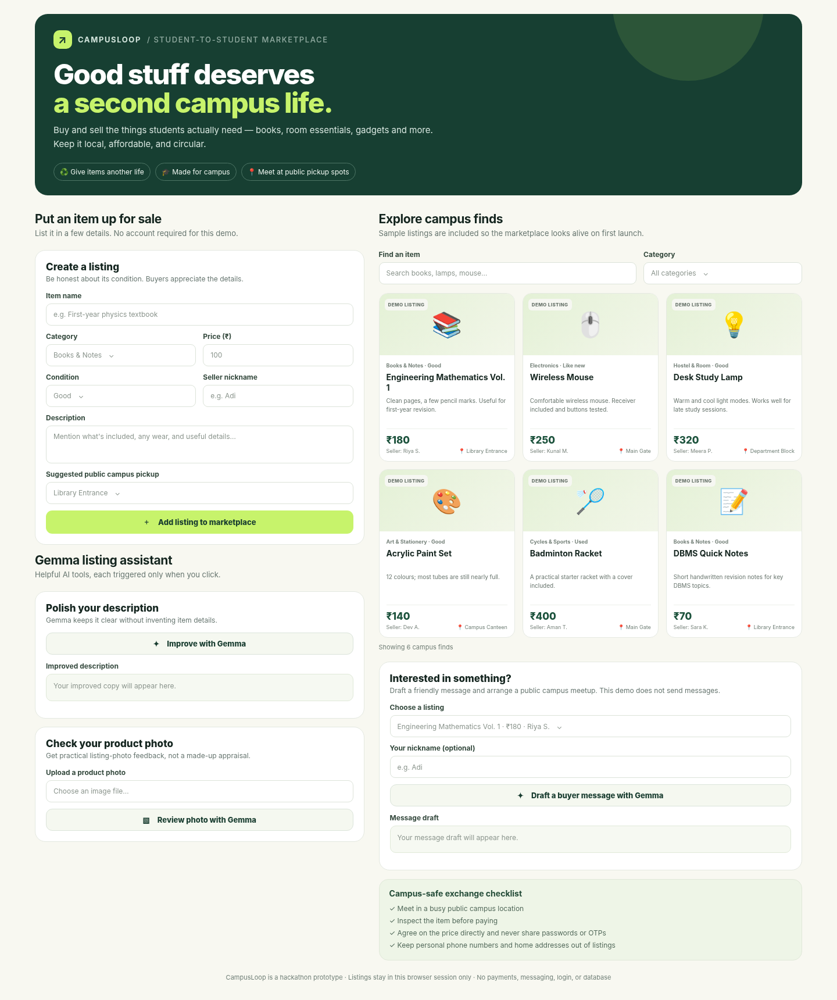

# CampusLoop — Student-to-student campus marketplace

CampusLoop is a one-screen hackathon prototype where college students can browse pre-loved items, add their own listing, and draft a polite buyer message. Gemma can help improve a listing description and give feedback on a product photo.

## Features

- **Browse and search:** sample listings for books, electronics, hostel items, sports gear, and stationery.
- **Sell:** add a title, category, price, condition, seller nickname, description, and a suggested public campus pickup point.
- **Gemma listing assistant:** improve a description without inventing item features.
- **Photo feedback:** ask Gemma for observable photo/listing-quality feedback.
- **Buyer message draft:** generate a short, polite inquiry about a chosen listing.
- **Campus safety reminders:** encourage public meetups and discourage sharing private information.

> **Prototype limitation:** this version has no login and no database. New listings exist only in the current app session and do not sync to other students or devices. The sample listings are demonstration data. It does not process payments or send messages. This keeps the project within the no-database/no-login requirement while making the demo interactive.

## Model and API

- **Model:** `gemma-4-26b-a4b-it` (kept fixed in `gemma_client.py`)
- **SDK:** `google-genai` via `from google import genai`
- **Key:** `GEMINI_API_KEY`, loaded from `.env` with `python-dotenv`
- **Gemma requests:** only happen after a user clicks one of the three AI buttons. Each AI button click makes one model inference. Adding a listing and searching the marketplace make no Gemma call.

## How to run

Python 3.13 is recommended for a smooth Windows setup.

### 1. Create a virtual environment

Windows CMD:

```cmd
py -3.13 -m venv .venv
.venv\Scripts\activate
python -m pip install --upgrade pip
```

macOS/Linux:

```bash
python3.13 -m venv .venv
source .venv/bin/activate
python -m pip install --upgrade pip
```

### 2. Install dependencies

```bash
python -m pip install -r requirements.txt
```

### 3. Add your Gemini API key

1. Copy `.env.example` to a new file named `.env` in the project root.
2. Open `.env` and set `GEMINI_API_KEY=your_key_here` using your own key from Google AI Studio.
3. Keep `.env` private. The `.gitignore` already excludes it. Never paste the key into Python files, screenshots, or public repositories.

Get a key from [Google AI Studio](https://aistudio.google.com/app/apikey).

### 4. Run CampusLoop

```bash
python app.py
```

Open the local URL printed in the terminal (usually `http://127.0.0.1:7860`). You can browse and add demo listings without a key; the Gemma-powered buttons need a valid `GEMINI_API_KEY` and internet connection.

## Screenshot



## Code map — judge-friendly explanation

- `app.py` builds the one-screen Gradio interface, stores temporary listings in session state, filters items, and connects buttons to their Python functions.
- `gemma_client.py` is the shared API helper. It loads `.env`, reads the key from the environment, fixes the model name, and exposes `ask()`, `ask_with_image()`, and `make_chat()`.
- `requirements.txt` lists the Python libraries.
- `.env.example` shows the required environment variable name without containing a real secret.
- `.gitignore` prevents `.env`, virtual environments, and temporary files from being committed.
- `LICENSE` contains the MIT license.

## Demo flow

1. Search sample listings or filter by category.
2. Add an item with your nickname and a public campus pickup point.
3. Click **Improve with Gemma** to rewrite the description honestly.
4. Optionally upload a product photo and click **Review photo with Gemma**.
5. Pick any listing and click **Draft a buyer message with Gemma**.

## Notes for a real deployment

This is intentionally a local demo, not yet a real multi-student marketplace. For a future production version, listings would need shared storage, authentication, moderation/reporting, and a safe way for students to contact each other. Those are not included here because the hackathon brief prohibits a database and login.
